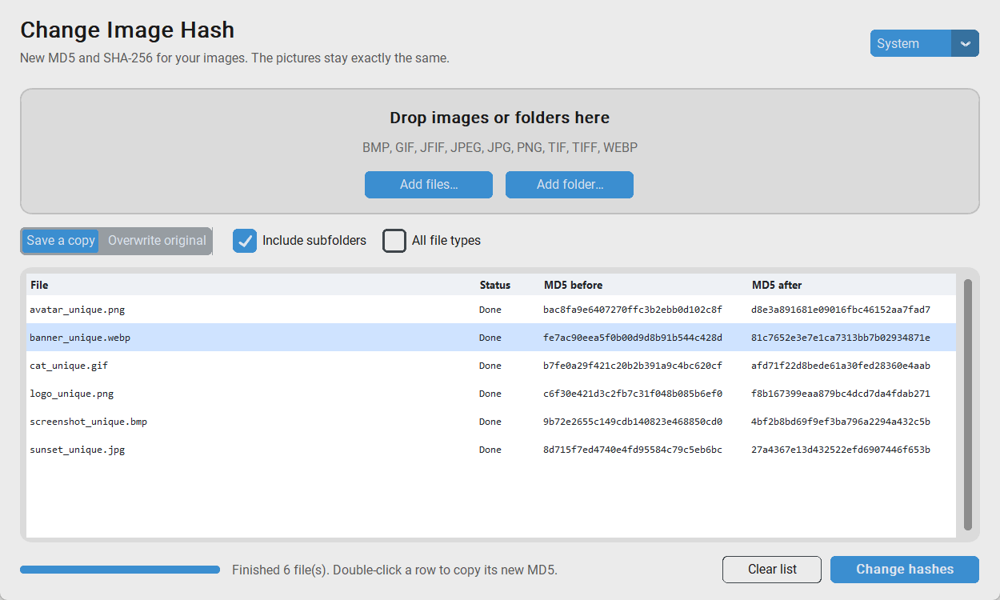

<div align="center">


# Change Image Hash

**Give any image a brand-new MD5 and SHA-256 hash — without changing a single pixel.**

[](https://github.com/SilentCasting/ChangeImagehashMD5/actions/workflows/ci.yml)
[](https://github.com/SilentCasting/ChangeImagehashMD5/releases/latest)
[](https://www.python.org/)
[](LICENSE)

English · [Українська](README.uk.md)

<picture>
  <source media="(prefers-color-scheme: dark)" srcset="docs/screenshot-dark.png">
  
</picture>

</div>

## Why

Many systems recognise files by their checksum: upload services, caches, backup
and deduplication tools. Two copies of the same picture always have the same
MD5, so they are treated as one file. Change Image Hash makes each copy
byte-unique while it still **looks exactly the same**.

Typical uses:

- testing upload pipelines, CDNs and dedup logic with "different" files;
- busting caches that key on the file hash;
- keeping several independent copies of one image.

## Features

- 🖱️ **Drag & drop** files or whole folders into the window
- 📦 **Batch processing**, including subfolders
- 🔍 **MD5 before / after** table; double-click to copy, right-click for SHA-256
- 🛡️ **Originals stay safe**: a `photo_unique.png` copy is saved by default
- ✅ **Files stay valid**: data goes into proper metadata blocks where possible
- 🖼️ PNG, JPG/JPEG/JFIF, GIF, WEBP, BMP, TIFF, or any file with "All file types"
- 🌗 Light and dark theme
- ⌨️ **Command line tool** for scripts and automation
- 💾 **Portable `.exe`** for Windows; no Python needed

## Download

Grab **`ChangeImageHash.exe`** from the
[latest release](https://github.com/SilentCasting/ChangeImagehashMD5/releases/latest)
and run it. Nothing to install.

> Windows SmartScreen may warn about an unknown publisher because the exe is
> not code-signed. Click **More info → Run anyway**, or build it yourself
> from source (see below).

## Install from source

Requires Python 3.10+.

```bash
git clone https://github.com/SilentCasting/ChangeImagehashMD5.git
cd ChangeImagehashMD5
pip install .
```

This installs two commands: `changeimagehash-gui` (the app) and
`changeimagehash` (the CLI).

## Usage

### Desktop app

```bash
changeimagehash-gui
```

1. Drop images or folders into the window, or use **Add files… / Add folder…**.
2. Choose **Save a copy** (default) or **Overwrite original**.
3. Click **Change hashes**.
4. Double-click a row to copy the new MD5. Right-click for the new SHA-256,
   the old MD5, **Show in folder** and **Remove from list**.

You can also drop files onto `ChangeImageHash.exe` itself to open them in the app.

### Command line

```bash
# Save photo_unique.png next to photo.png
changeimagehash photo.png

# Every image in a folder and its subfolders, copies go to ./out
changeimagehash ./pictures -r -o ./out

# Modify the originals in place
changeimagehash *.jpg --overwrite

# Machine-readable output
changeimagehash photo.png --json
```

```text
photo.png -> photo_unique.png  [PNG text chunk]
    MD5     d227449bf4070a982e50c6d58f00875a -> 5135ad83f604466fc6125987fa1b635a
    SHA-256 4ca98f2081fb7384ce9db79889cdbe3c8c1a8c68e5c1d9f4993e9385495a52f6 -> 77314646119172aef74b5e827f138bb796b169a8cc6f814ae1ac3ed9bffe9f02

Done: 1 changed, 0 failed.
```

| Option | Description |
| --- | --- |
| `--overwrite` | Modify the original files instead of saving copies |
| `-o, --output-dir DIR` | Save copies into `DIR` |
| `--suffix TEXT` | Suffix for copies (default `_unique`) |
| `-r, --recursive` | Include images in subfolders |
| `--all-files` | Process every file in folders, not just images |
| `--json` | Print results as JSON |

Exit codes: `0` success, `1` some files failed, `2` nothing to do or bad arguments.

### As a library

```python
from changeimagehash import change_hash

result = change_hash("photo.png")
print(result.output, result.before.md5, "->", result.after.md5)
```

## How it works

32 random hex characters are written into the file in a place that image
viewers skip, so the pixels never change but the bytes (and the hash) do.

| Format | Where the random data goes | File stays spec-valid |
| --- | --- | :---: |
| PNG | A `tEXt` chunk named `ChangeImageHash`, right before `IEND` | ✅ |
| JPEG | A `COM` comment segment, after the JFIF/EXIF headers | ✅ |
| GIF | A comment extension before the trailer (GIF87a is upgraded to 89a) | ✅ |
| WEBP, BMP, TIFF, other | Appended after the end of the image data | Decoders ignore it |

Every run uses new random data, so the same image processed twice gets two
different hashes. EXIF and other metadata are kept.

> **Note:** this changes *cryptographic* hashes (MD5, SHA-1, SHA-256, …).
> It does not change *perceptual* hashes (pHash, dHash) or anything that
> compares the picture itself, because the picture is identical by design.

## Development

```bash
python -m venv .venv
.venv\Scripts\activate          # Linux/macOS: source .venv/bin/activate
pip install -e ".[dev,build]"

pytest                          # run the tests
ruff check . && ruff format .   # lint and format
python packaging/build_exe.py   # build dist/ChangeImageHash.exe
```

The tests generate real images in every format, change their hashes and
check with Pillow that every pixel is still identical.

### Releasing

Bump `__version__` in `src/changeimagehash/__init__.py`, update
`CHANGELOG.md`, then push a tag:

```bash
git tag v1.0.0
git push origin v1.0.0
```

GitHub Actions runs the tests, builds the exe and publishes the release.

### Project layout

```text
src/changeimagehash/
├── formats.py   # format detection and where to hide the random bytes
├── core.py      # change_hash(), collect_files(), hashing, safe writes
├── cli.py       # command line interface
├── gui.py       # CustomTkinter desktop app
└── assets/      # app icon
tests/           # pytest suite
packaging/       # PyInstaller build script
```

## License

[MIT](LICENSE) © SilentCasting
